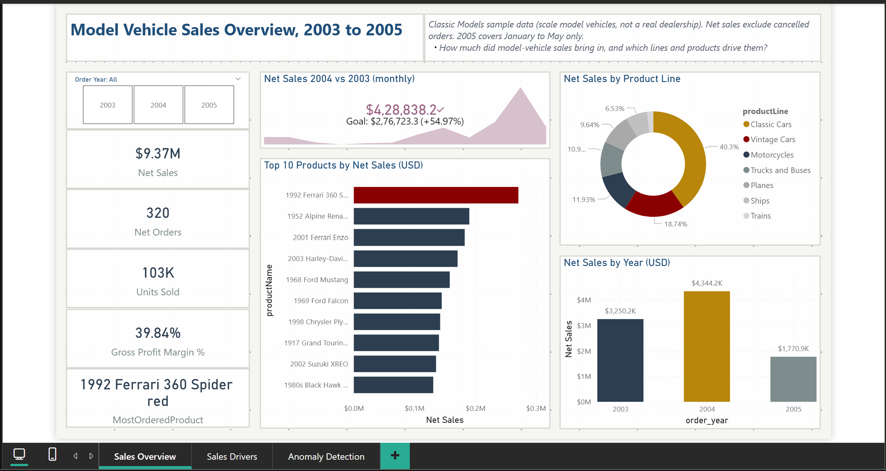

# Model Vehicle Sales Performance Analytics


[](screenshots/01_sales_overview.png)

*Select the image to view it at full size.*

---

## Project Overview

A three-page Power BI dashboard analysing sales of scale model vehicles (1:10 to 1:24). It covers sales performance, the drivers behind it, and unusual sales days.

The dataset describes scale model vehicles, not a real car dealership. The analysis shows how model-vehicle sales perform over time and across product lines, and which products, customers and periods explain most of the sales.

### Data Source

**Data Source:** Secondary data obtained from publicly available online sources for educational and analytical practice. The dataset was used for data preparation, analysis, dashboard development, and business insights.

---

## Headline KPIs (net of cancelled orders)

| Net Sales (2003 to 2005) | Net Orders | Units Sold | Gross Profit Margin |
|---|---|---|---|
| $9.37M | 320 | 102,882 | 39.8% |

*Currency: US dollars, assumed. The dataset does not state a currency. Cancelled orders are excluded from all sales KPIs.*

---

## Business Questions

1. How much did the business sell, and how is it trending year on year?
2. Which product lines and products drive net sales?
3. Which product lines, customers and products explain the level of sales?
4. Which days deviate sharply from the expected sales pattern?

---

## Dataset

| Item | Detail |
|---|---|
| Period | 6 January 2003 to 31 May 2005 |
| Orders | 326 in total, 320 after excluding 6 cancelled |
| Order lines | 2,996 |
| Products | 110 in the catalogue, 109 of which were ordered |
| Product lines | 7 |
| Customers | 122 in the customer table, 98 of which placed orders |
| Currency | US dollars, assumed |

The data is stored as eight linked tables: orders, order details, products, product lines, customers, employees, offices and payments.

### Limitations of the data
- **2005 is partial.** Data runs only to 31 May 2005. Year-on-year comparisons use 2003 and 2004 only.
- **Cancelled orders are excluded** from net sales. Six orders are cancelled, worth $238,854 of gross sales.
- **Some orders are still open.** Orders marked In Process, On Hold or Disputed are included in net sales.
- **Sparse daily data.** With 320 orders over about 880 days, daily anomaly flags are sensitive to single orders.
- **Teaching dataset.** It is not real transaction data.

---

## Data Model

| Table | Grain | Key columns used |
|---|---|---|
| orders | One row per order | orderNumber, orderDate, status, customerNumber |
| order details | One row per product line item | orderNumber, productCode, quantityOrdered, priceEach |
| products | One row per product | productCode, productName, productLine, buyPrice |
| productlines | One row per product line | productLine, description |
| customers | One row per customer | customerNumber, city, country |

---

## KPI Definitions

| KPI | Logic |
|---|---|
| Gross Sales | Sum of quantityOrdered × priceEach, all statuses |
| Net Sales | Gross Sales excluding cancelled orders |
| Net Orders | Distinct count of orderNumber, excluding cancelled |
| Units Sold | Sum of quantityOrdered, excluding cancelled |
| Gross Profit | Sum of quantityOrdered × (priceEach − buyPrice), excluding cancelled |
| Gross Profit Margin % | Gross Profit ÷ Net Sales |
| Net Sales 2004 vs 2003 % | (Net Sales 2004 − Net Sales 2003) ÷ Net Sales 2003 |
| Net Sales Full Years | Net Sales for 2003 and 2004 only, excluding partial 2005 |

Measures are in [`documentation/measures.dax`](documentation/measures.dax).

---

## Dashboard Pages

**Page 1: Sales Overview.** Answers: *How much did model-vehicle sales bring in, and which lines and products drive them?* KPI cards for net sales, net orders, units sold, gross profit margin and the most ordered product. Also shows a 2004 vs 2003 monthly comparison, net sales by product line, a top-10 product chart, a customer map and net sales by year.

**Page 2: Sales Drivers.** Answers: *Which product lines, customers and products explain the level of sales?* A decomposition tree on net sales (product line, then customer, then product), and a key influencers visual.

**Page 3: Anomaly Detection.** Answers: *Which days deviate sharply from the expected sales pattern?* A daily net sales line chart with Power BI anomaly detection. Flags are statistical outliers, not confirmed errors.

---

## Key Insights

All figures reproduce from the data files.

- **Sales grew strongly in 2004.** Net sales rose from $3.25M in 2003 to $4.34M in 2004, an increase of 33.7%.
- **Classic Cars are the core business.** They account for 40.3% of net sales, followed by Vintage Cars (18.7%) and Motorcycles (11.9%).
- **One product leads.** The 1992 Ferrari 360 Spider red is the top product by sales ($271,015) and by units (1,768).
- **Sales are concentrated among few customers.** The top five customers account for 20.1% of net sales, out of 98 customers who placed orders.
- **Late-year peaks.** November was the highest month in both 2003 ($965,062, about 30% of that year's net sales) and 2004 ($979,292, about 23%). October also rose sharply in both years, from $236,698 to $470,169 in 2003, and to $500,234 in 2004 from September's $283,800.

### Suggested actions (for discussion, not tested)

- Review stock and production planning ahead of the October and November peak.
- Look at the top five customers as a group for retention and account management, since they make up a fifth of net sales.

---

## Tools and Techniques

- **Power BI Desktop:** data model, DAX measures, report design, visuals.
- **DAX:** net-of-cancellations measures, fixed-year comparisons (excluding partial 2005), profit measures and a data-through label.
- **Power BI visuals:** decomposition tree, key influencers, anomaly detection on a line chart, top-N filters, map and slicers.

---

## Repository Structure

```text
model-vehicle-sales-analytics/
├── README.md
├── dashboard/
│   └── vehicle-sales-dashboard.pbix
├── data/
│   ├── customers.csv
│   ├── employees.csv
│   ├── offices.csv
│   ├── order details.csv
│   ├── orders.csv
│   ├── payments.csv
│   ├── productlines.csv
│   └── products.csv
├── documentation/
│   └── measures.dax
└── screenshots/
    ├── 01_sales_overview.png
    ├── 02_sales_drivers.png
    ├── 03_anomaly_detection.png
    └── 04_data_model.png
```

---

## How to View and Refresh

1. Open `dashboard/vehicle-sales-dashboard.pbix` in Power BI Desktop.
2. If a file-not-found error appears, go to **Home > Transform data > Data source settings** and point each source to the matching file in `data/`.
3. Click **Refresh**. Net Sales should show $9.37M.

---

## Limitations

- **Partial 2005.** Year-on-year figures use 2003 and 2004 only.
- **Revenue and gross profit only.** No overheads, freight or returns.
- **Daily anomalies are noisy.** With 320 orders over about 880 days, roughly one order every three days, so a single order can flag as an outlier.
- **Association, not cause.** Product lines and customers explain sales levels in this data, but do not show why.

---

## Disclaimer

This is a portfolio project using secondary data. Results describe that dataset only and do not represent a real business or dealership.

---

**Author:** [Sarthak Jaykar](https://www.linkedin.com/in/sarthak-jaykar/)